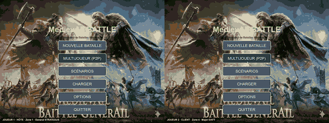
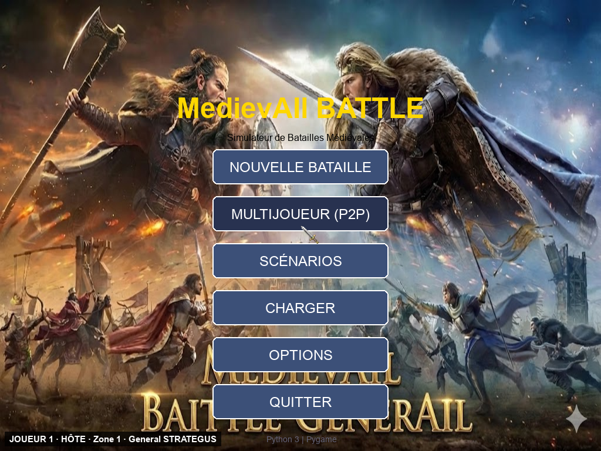
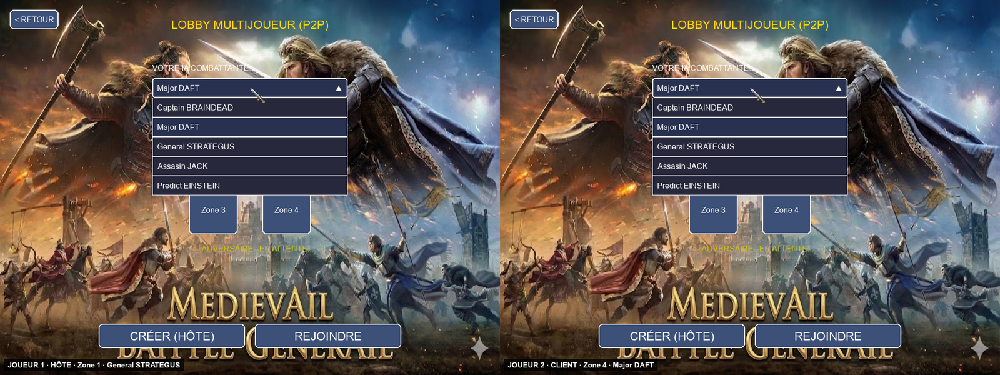
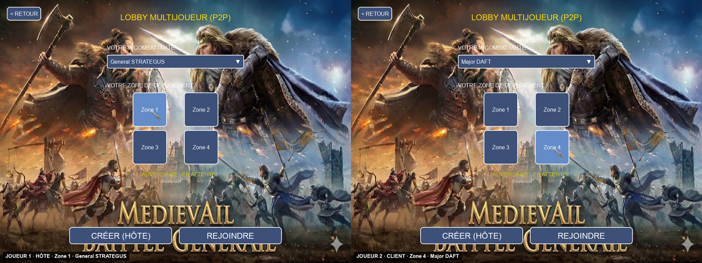
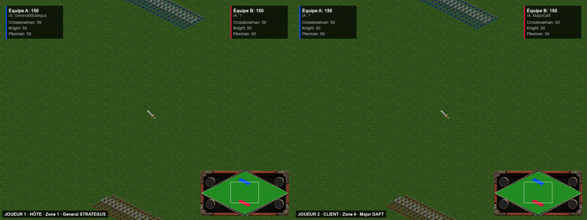
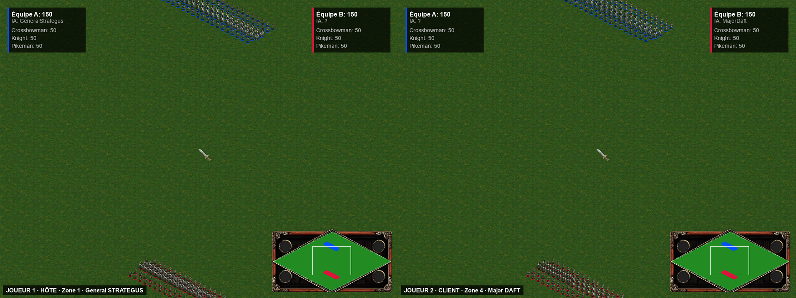
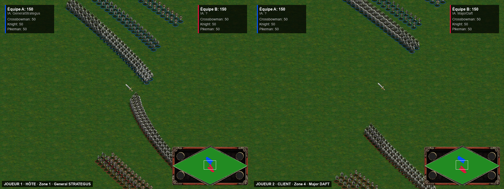
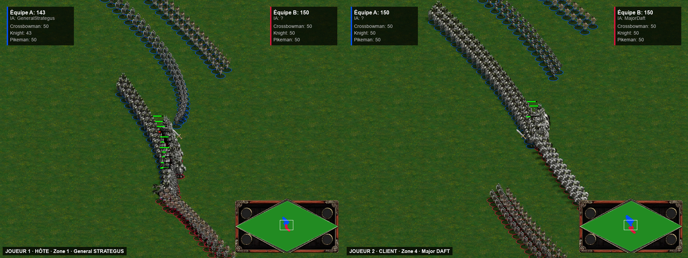
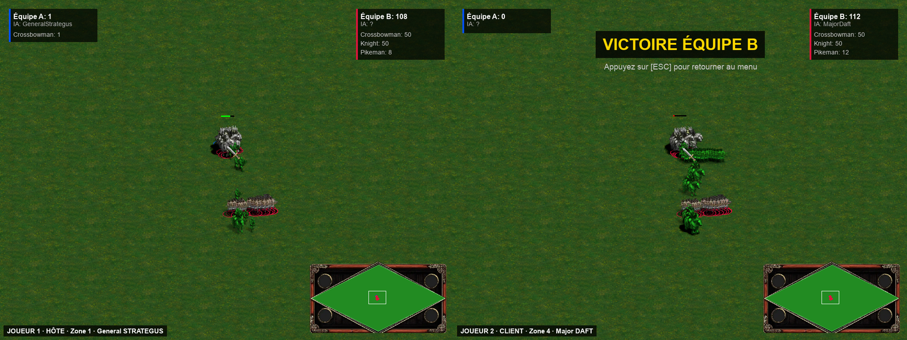

# Démo — MedievAIl Battle P2P



> Aperçu accéléré x3. **[Vidéo complète : `demo.mp4`](demo.mp4)** (77 s, 1600×600, 30 images/s). À gauche le **joueur 1 (hôte)**, à droite le **joueur 2 (client)**.

## Ce que montre la démo

Une partie multijoueur complète, **deux joueurs sur la même machine**, chacun avec son propre daemon réseau C :

1. **Lobby P2P** : le joueur 1 choisit *General STRATEGUS* et la zone 1, le joueur 2 choisit *Major DAFT* et la zone 4. Les choix s'échangent par UDP via les deux daemons C (`reseau.c`, ports 6000 ↔ 6001).
2. **Placement** : les deux armées (150 unités chacune) sont déployées dans leur quadrant.
3. **Combat** : les deux joueurs appuient sur `ENTRÉE` ; chaque processus Python fait jouer son IA et diffuse l'état de ses unités à l'autre par son daemon C.
4. **Fin de bataille**.

Sur cette exécution, les daemons ont acheminé **662 paquets** (hôte → client) et **384 paquets** (client → hôte).

## Ce qu'on observe

- Le handshake du lobby, le placement et le début du combat se déroulent comme décrit dans le README : les deux écrans affichent les mêmes armées, et les unités de chaque camp bougent à l'écran de l'adversaire.
- **Les deux vues finissent par diverger.** À la fin de l'exécution, l'écran du client affiche « Victoire équipe B » (équipe A : 0, équipe B : 112), alors que l'hôte affiche encore équipe A : 1 et équipe B : 108 et n'a pas détecté de fin de partie. Des unités teintées en vert (drapeau `is_zombie`, unités tuées localement puis « ressuscitées » par un état réseau reçu) sont visibles pendant la mêlée.
- Les captures finales (`08_fin_de_bataille.png`) ne sont pas prises au même instant : le client a terminé sa bataille plus tôt que l'hôte (77 s contre 117 s enregistrées).

Ces observations proviennent d'une seule exécution. Le cadencement du script de capture (rendu sans fenêtre, images traitées à des vitesses différentes selon le joueur) peut aussi influencer la synchronisation ; elles ne suffisent donc pas à établir la cause exacte.

## Note macOS : taille des paquets UDP

Sur macOS, la taille maximale d'un datagramme UDP est limitée à 9216 octets par défaut (`sysctl net.inet.udp.maxdgram`), et `reseau.c` ne règle pas `SO_SNDBUF`. Un paquet de synchronisation de 2 armées de 150 unités fait environ 12,5 Ko : avec le daemon tel quel, il est perdu (testé avec un paquet de 12 Ko). `capture_demo.py` compile donc une **copie temporaire** de `reseau.c` avec des tampons UDP agrandis ; **`reseau.c` n'est pas modifié dans le dépôt**.

## Captures d'écran

Sauf la première, chaque capture montre le joueur 1 (hôte, à gauche) et le joueur 2 (client, à droite).

| | |
| :-- | :-- |
| <br>**01** Menu principal (bouton *Multijoueur (P2P)*) | <br>**02** Lobby : choix de l'IA |
| <br>**03** Lobby : IA et zone choisies | <br>**04** Placement des armées |
| <br>**05** Début du combat | <br>**06** Les armées avancent l'une vers l'autre |
| <br>**07** Zoom sur la mêlée | <br>**08** Fin de bataille (vues différentes) |

## Comment la démo a été réalisée

[`capture_demo.py`](capture_demo.py) exécute **le vrai jeu et le vrai daemon réseau**, sans modifier leur code : il compile le daemon, lance deux daemons et deux instances du jeu (hôte et client) en parallèle, puis assemble les deux enregistrements côte à côte. Seuls la souris, le clavier et l'horloge de chaque joueur sont pilotés par un scénario scripté, et l'affichage utilise le pilote SDL `dummy` (aucune fenêtre ne s'ouvre). Chaque image dessinée par le jeu est enregistrée à 30 images/s en temps virtuel.

Pour régénérer la vidéo, le GIF et les captures (depuis la racine du dépôt) :

```bash
pip install pygame   # ffmpeg et un compilateur C (cc / gcc) doivent être installés
python demo/capture_demo.py
```
